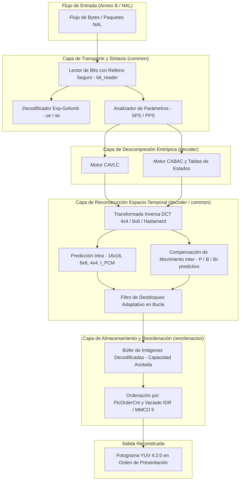

# Arquitectura del Sistema — Crusty_H264

## 1. Filosofía de Diseño y Principios Rectores

El diseño de **Crusty_H264** responde a una necesidad primordial: construir un decodificador de vídeo de altas prestaciones cuya seguridad esté garantizada a nivel del compilador, sin comprometer la fidelidad estricta al estándar UIT-T H.264.

Los cuatro pilares arquitectónicos que gobiernan el código son:

1. **Inmunidad de Memoria por Construcción**:
   Todo el código de producción en los dos crates (`common` y `decoder`) aplica `#![forbid(unsafe_code)]`. No existen bloques `unsafe`, ni punteros crudos sin encapsular, ni llamadas FFI hacia librerías externas en C.

2. **Modularidad SOLID y Separación de Responsabilidades**:
   El código original concentraba la decodificación de macrobloques en archivos gigantescos de más de 8.500 líneas (como `mb16.rs`). La serie de refactorización nuclear (`NUC`) descompuso este monolito en submódulos especializados donde cada uno tiene una única responsabilidad matemática o de flujo.

3. **Cota Estricta de Retención de Recursos (Bounded DPB)**:
   A diferencia de los decodificadores convencionales que retienen flujos completos en memoria para reordenar fotogramas por POC (*Picture Order Count*), Crusty_H264 implementa un búfer acotado que calcula matemáticamente la capacidad del DPB según el nivel del estándar (Tabla A-1, acotado entre 1 y 16 fotogramas).

4. **Tratamiento Centralizado y Tipado de Errores**:
   No se emplean pánicos (`panic!`), ni llamadas descontroladas a `unwrap()` o `expect()` en rutas de decodificación. Ante flujos malformados, truncados o deliberadamente hostiles, el sistema propaga un error tipado y enriquecido (`DecodeError`).

---

## 2. Diagrama de Capas y Flujo de Decodificación

---

## 3. Descomposición Modular

### 3.1. Crate `crusty_h264-common`
Concentra las definiciones matemáticas, estructuras de datos compartidas y primitivas agnósticas al perfil:
- **`bit_reader.rs`**: Lector de bits con lectura anticipada segura (`peek_bits`), consumo controlado y detección estricta de fin de datos (`OutOfData`).
- **`bit_writer.rs`**: Constructor de flujos RBSP con prevención de emulación y serialización de sintaxis.
- **`cavlc.rs`**: Tablas de códigos de longitud variable y decodificación de coeficientes residuales.
- **`predict.rs`**: Algoritmos de predicción espacial intra para luminancia y crominancia.
- **`transform.rs`**: Transformadas inversas discretas del coseno enteras (4x4 y 8x8), transformadas de Hadamard para bloques DC y desescalado cuántico.
- **`inter/`**: Compensación de movimiento a resolución de cuarto de píxel con filtrado Wiener de 6 tomas para semipíxel e interpolación bilineal para cuarto de píxel.
- **`deblock/`**: Filtro de desbloqueo adaptativo de bordes conforme a la sección 8.7 de la norma UIT-T.

### 3.2. Crate `crusty_h264-decoder`
Implementa la máquina de estados que orquesta la interpretación del flujo:
- **`cabac/` y `cabac_residuo.rs`**: Decodificación aritmética binaria adaptativa contextual.
- **`mb_cabac_slice/`**: Procesamiento de macrobloques en cortes codificados con CABAC (`intra.rs`, `p.rs`, `b.rs`, `estado.rs`).
- **`mb_inter/`**: Modularización de macrobloques interpredictivos (`vecinos.rs`, `residuo.rs`, `p_cavlc.rs`, `b_mc.rs`, `b_directo.rs`, `b_skip.rs`).
- **`mb_intra/`**: Reconstrucción intraparticionada unificando modos de predicción y cálculo de remanentes (`prediccion.rs`, `recon.rs`, `cavlc.rs`).
- **`poc.rs` y `dpb.rs`**: Aritmética de cálculo del orden de imagen (tipos 0, 1 y 2) y gestión del búfer de imágenes decodificadas con operaciones MMCO 1..6.
- **`reordenacion.rs`**: Módulo autónomo que asegura que la entrega de fotogramas al consumidor se realiza en orden de presentación estricto respetando la cota de memoria del perfil.

---

## 4. Garantías de Rendimiento y Memoria

1. **Asignación Acotada**: Se preasignan búferes de trabajo reutilizables a través de un pool interno (`pool.rs`), evitando constantes llamadas a `malloc` en el bucle principal de fotogramas.
2. **SIMD Seguro y Portátil**: Empleo de las librerías `safe_arch` y `wide` que generan instrucciones vectoriales (AVX2, SSE4.1, NEON) garantizando la ausencia total de código inseguro.
3. **Control de Fugas**: No existen ciclos de referencias ni punteros compartidos complejos; la propiedad de los fotogramas decodificados fluye linealmente desde el decodificador hacia el consumidor.
